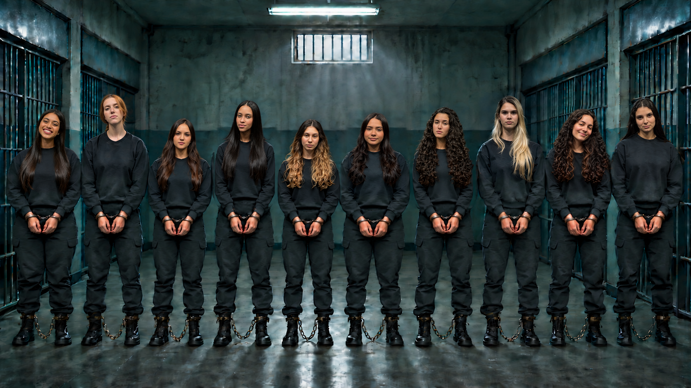
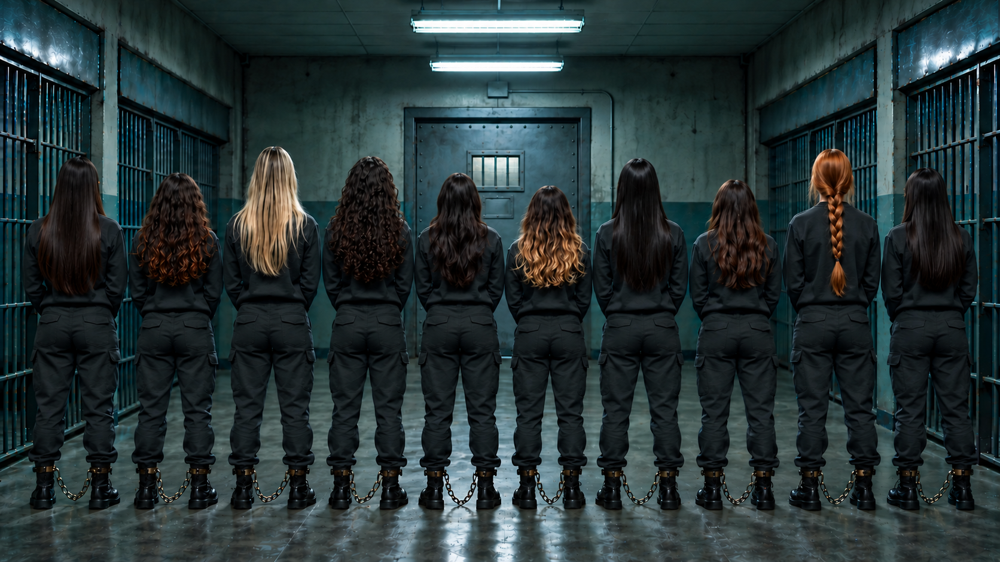

# MM01 — imagens canônicas da abertura interna

Para montar e ensaiar, siga o [Roteiro de montagem do telão](../../../guias/cena-a-cena/pdf/HESED-roteiro-de-montagem.pdf). Leia cada deixa na ordem do palco: fala ou ação, entrada da música, imagem a sustentar e sinal de saída.

Cópias exatas das duas imagens aprovadas por Victor em23/10/2026, preservadas na resolução nativa1672×941. Não houve geração, recorte, correção de cor ou nova aprovação nesta publicação. São referências visuais; não são masters de vídeo1080p nem prova de ensaio LED.

## Frontal V13

SHA-256:`dab152c61872be374bea664fa3ec26244fd2a277f6aa00f71b38d620cda983ac`.

## Contraângulo pelas costas V01

SHA-256:`873d57015bbaf296928fa6c277adcb186e68a8aaa597befb34a9e837ea2cde51`.

## Função e preservação

São o primeiro movimento do vídeo: corredor/prisioneiras→luz/desvanecimento→exterior da cadeia sem detentas projetadas, entregando a ação ao palco. A referência exterior V06/D-40/D-41 permanece preservada em [storyboards/MM-01](../../../storyboards/MM-01/README.md). As correntes destas imagens iniciais pertencem ao conteúdo projetado, sem ordenar construção de contenção física no palco.

O [registro de produção](../../../docs/producao-victor/README.md) distingue as imagens aprovadas da prévia de animação V04 ainda em revisão. Evidências de aprovação e manifesto estão em [produção de Victor](../../../docs/producao-victor/evidencias/README.md). O editávelORA e os demais projetos/mídias permanecem locais, conforme o guia.
