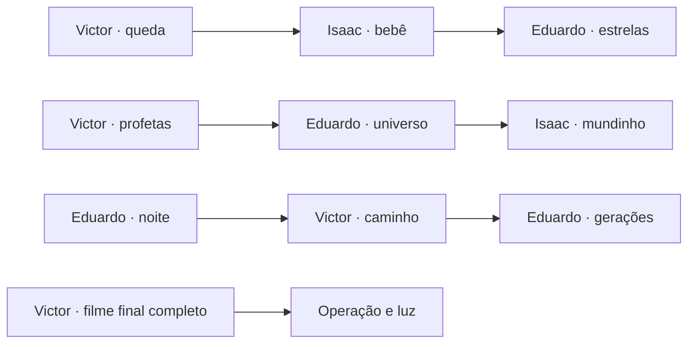

# Dependências de produção e operação

| Quem termina | O que a próxima pessoa precisa ver | Quem usa |
| --- | --- | --- |
| Victor · MM-05 | Último quadro da queda e fala sobre enviar alguém para salvar | Isaac começa a regressão MM-06 |
| Isaac · MM-06 | Último bebê, sustentado no diálogo | Eduardo abre o céu da MM-07 |
| Victor · MM-02 | Indicação dos cortes de Goel já usados | Isaac escolhe a Páscoa da Cena 4 |
| Victor · MM-09 | Último quadro da visão dos profetas | Eduardo entra com o universo MM-10 |
| Eduardo · MM-10 | Última luz da narração | Isaac abre o mundinho MM-11 |
| Eduardo · MM-13 | Último céu de Ó Noite Santa | Victor abre o caminho MM-12 |
| Victor · MM-12 | Q06 vazio sustentado; anjos v09 na fala da multidão | Operação prepara a entrada posterior das gerações de Eduardo |
| Eduardo · Santo pra Sempre | Final da música | Operação volta à casa de Victor |
| Victor · MM-14, MM-15 e Brilha Tua Luz | Casa, nascimento, atos de Jesus, frase, música e cortina | Operação da Cena 8 |
| Victor · MM-16 | Filme final pronto, marca da parte falada e sinal do último refrão | Operação e iluminação |

Victor produz a MM-16 inteira, incluindo seleção ou criação das imagens, eventual gravação, edição, finalização e entrega direta à operação. A–D identificam referências de acervo. O filme independe de qualquer material a preparar, separar ou enviar pelos demais.

[Guia definitivo por pessoa](../guias/cena-a-cena/quem-faz-as-musicas.md)
