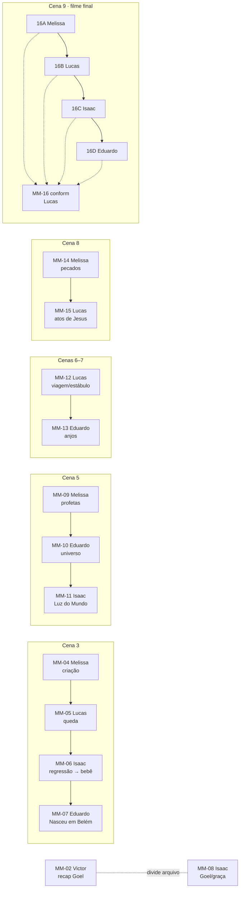

# Dependências entre produtores

Toda peça que encosta em outra tem uma **costura**: o último frame de uma precisa conversar com o primeiro da próxima, e as duas precisam usar paleta, escala e velocidade de movimento compatíveis. Se uma costura falha, o público vê a emenda.

Regra: **quem entrega primeiro manda o último frame (PNG em resolução final) + paleta + duração aproximada assim que tiver o alpha**, sem esperar o render final.

## Costuras

| De | Para | O que passa | Por que importa |
| --- | --- | --- | --- |
| MM-04 (Melissa) | MM-05 (Lucas) | Imagem-base e paleta da criação | A queda é a corrupção *do mesmo mundo*, não um vídeo novo |
| MM-06 (Isaac) | MM-07 (Eduardo) | Frame/loop do bebê | Nasceu em Belém começa de onde a regressão parou (ver D-01) |
| MM-09 (Melissa) | MM-10 (Eduardo) | Último estado visual dos profetas | Passagem do histórico para o cósmico |
| MM-10 (Eduardo) | MM-11 (Isaac) | Último estado do universo/luz | Luz do Mundo nasce da luz que o MM-10 deixou |
| MM-12 (Lucas) | MM-13 (Eduardo) | Paisagem noturna/estábulo à esquerda da imagem (D-45), com volume ampliado para a direita; campo à direita | O nascimento cresce no mesmo espaço até a glória; preservar casa à esquerda e caminho à direita da casa em Q03–Q05, curvando para a esquerda em profundidade |
| MM-14 (Melissa) | MM-15 (Lucas) | Ritmo de corte e tratamento de cor | Contraste deliberado: aprisionamento → restauração |
| MM-02 (Victor) | MM-08 (Isaac) | Lista de takes de Goel usados | Evitar repetir as mesmas imagens (P-04) |
| MM-16A/B/C/D | MM-16 (Lucas) | Módulos com margem nas pontas | Conform precisa de "sobra" para transicionar |

## Diagrama

## Quem depende de quem (resumo por pessoa)

- **Victor:** combina arquivo de Goel com Isaac.
- **Melissa:** entrega para Lucas (MM-04, MM-14), Eduardo (MM-09) e Lucas no conform (16A).
- **Isaac:** entrega para Eduardo (MM-06); recebe de Eduardo (MM-10); combina com Victor (Goel); entrega 16C para Lucas.
- **Eduardo:** recebe de Isaac (MM-06), Melissa (MM-09) e Lucas (MM-12); entrega para Isaac (MM-10) e 16D para Lucas.
- **Lucas:** recebe de Melissa (MM-04, MM-14) e de todos no MM-16; entrega para Eduardo (MM-12). É o gargalo do final, então os módulos do MM-16 precisam chegar cedo.
