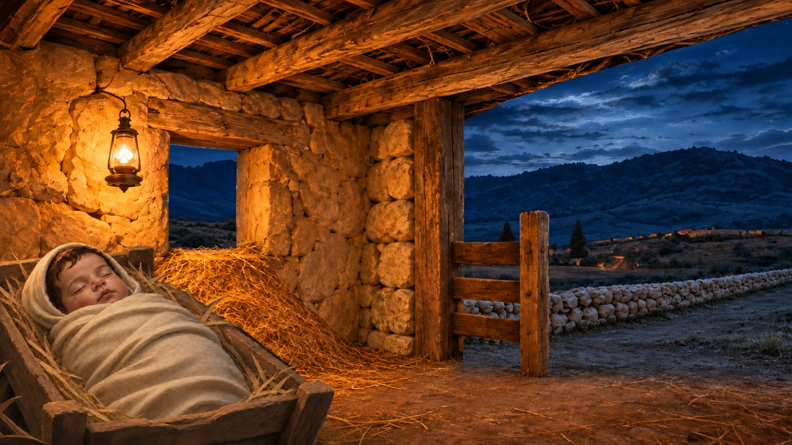

# HESED · MM-06-Q04 · Nascimento · Composição v01

**27/11/2026 · Cena 3 · Isaac · proposta para avaliação.** Último quadro da regressão cruz → milagres → infância → bebê. [Ficha da MM-06](../README.md) · [Cena 3](../../../guias/cena-a-cena/cena-03.md)

## Provas

- [Composição editável em HTML](index.html). Abra o arquivo localmente mantendo a pasta irmã [midia-retomada](../midia-retomada/). **Neutro** retorna ao quadro acima. **Reproduzir parallax** percorre os extremos e retorna ao neutro em ciclo de teste. O controle de deslocamento permite inspecionar qualquer posição. **Fala coletiva · Cena 8** ativa a camada de texto.
- [Parallax nos dois extremos](prova-parallax.jpg). A porteira permanece presa ao batente, a mureta fica atrás da estrebaria e a pilha de feno chega à base da janela lateral.
- [Fim da regressão e estrela candidata, lado a lado](passagem-MM07.jpg). A [MM-07-P01](../../MM-07/camadas-gravura-v01/cenas/MM07-P01.png) é a referência para Isaac comparar a mudança do interior quente para o céu estrelado em gravura. A escolha do primeiro quadro e da passagem fica com Isaac e a direção.
- [Fala coletiva da Cena 8](prova-fala-coletiva.jpg). “ELE NASCEU, E ISSO MUDA TUDO.” fica em camada de texto editável, com contraste localizado no lado direito e o rosto do bebê livre. Victor usa o quadro confirmado por Isaac tanto na lembrança do nascimento quanto na fala de todas. [Cena 8](../../../guias/cena-a-cena/cena-08.md)

## Montagem

Os seis planos da estrebaria V06 e o recorte de bebê/manjedoura da V12 conservam o registro de 1672 × 941. A manjedoura fica no primeiro plano esquerdo, sob a lanterna, a 82% com origem deslocada em (+8, +180) px. As bordas já cortadas no PNG ficam fora do quadro, com a base do móvel parcialmente fora de campo. Uma sombra no piso acompanha a manjedoura, e o recorte recebe um ajuste discreto de cor e brilho. A palha solta opcional da V12 fica de fora. A pilha e a palha que já fazem parte do interior V06 continuam no quadro.

No extremo positivo, os seis planos se deslocam em −17, −10, −4, +8, +8 e +20 px. O extremo negativo inverte os sinais. Estrebaria, porteira, manjedoura e sombra compartilham o deslocamento do piso. A área visível usa margem de segurança de 33 px nas laterais. A máscara localizada suaviza a emenda entre piso e terreno sob a porteira. Os PNGs de origem são os de [242399d](https://github.com/Luz-GMP/Musical-Hesed-GET/commit/242399da5ba1aee9726e0404889cd9b3dd16f3fd). [Manifesto de origem](../manifesto-retomada-2026-11-27.csv)

**Paleta e luz.** Âmbar da lanterna (#D58B36), linho quente no bebê (#D6B68D), madeira em sombra (#483022) e azul-noturno de Belém (#142E52). As cores são amostras de trabalho. A lanterna ilumina o interior pela esquerda e o exterior mantém o azul da noite.

## Deixas e revisão

| Momento | Deixa e imagem |
| --- | --- |
| Cena 3 · entrada da MM-06 | Mari, a Religiosidade, responde “Enviando alguém pra nos salvar” à pergunta da Profanação. A regressão começa antes de Q04. |
| Cena 3 · sustentação de Q04 | Manter o bebê enquanto as detentas conversam sobre o nascimento e Belém. Isaac valida quando Q04 entra e se a sustentação usa o ciclo ou repouso. |
| Cena 3 · saída para MM-07 | Após a conversa sobre Belém da Judeia e a resposta da Ladra, entra *Nasceu em Belém*, de Marcus Salles. Confirmar a passagem para o céu, a primeira estrela e a duração com o áudio e o ensaio. |
| Cena 8 · lembrança e fala coletiva | Mari fala do nascimento, antes de “Ele curou”. Na fala de todas, Victor retoma o bebê e ativa a frase. Sustentar até o GO de *Brilha Tua Luz*. Conferir leitura à distância e a deixa em ensaio. |

**Conferência técnica.** Originais verificados por tamanho e SHA-256. Sete PNGs decodificados no navegador, quadro neutro e ambos os extremos inspecionados, dez posições do ciclo verificadas e texto inspecionado no quadro. A duração de 16 s vale para a prova interativa. A aprovação de Isaac, a leitura no LED e as deixas de palco seguem pendentes. A entrega desta versão é o quadro e a composição para revisão. Qualquer MP4 posterior recebe marcadores próprios de entrada, sincronismo e saída, conferidos na exportação. [Guia de marcadores](../../../guias/timecodes-e-operacao.md)
