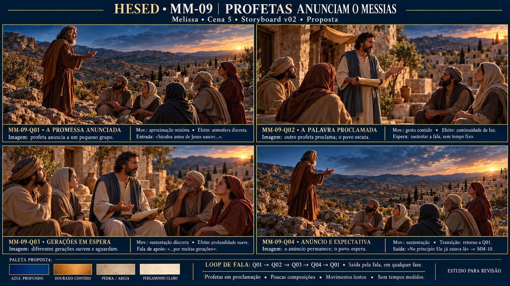

# Storyboard · MM-09 · Profetas anunciam o Messias

| | |
| --- | --- |
| **Responsável / cena** | Melissa · Cena 5 · Bloco III |
| **Versão / situação** | v02 · 16/10/2026 · proposta para revisão |
| **Recebe de** | Fornecedor/frame de entrada não definido |
| **Entrega para** | Eduardo/MM-10: estado visual/paleta; integração final pendente |
| **Entrada** | “Bom, séculos antes de Jesus nascer, houveram vários profetas que anunciaram a vinda dele” |
| **Saída** | “No princípio Ele já estava lá” |
| **Controle** | Fala variável, loop; sem música própria/timecodes |
| **Drive** | A definir (P-13), nenhum upload realizado |

## Prancha v02

**Correção de leitura do roteiro (D-26):** a Cena 5 pede “Profetas pregando e anunciando a vinda do Messias no telão”. A V01 priorizava paisagem/pergaminho/profeta isolado; nesta proposta, a proclamação é dirigida a ouvintes e a espera aparece nas pessoas. Preservar o loop contemplativo com poucas composições do briefing, sem aula projetada ou filme extenso.

[Prancha](prancha-v02.jpg) · [Prompt integral](prompt-prancha-v02.txt) · [Contrato/registro](../briefings-dos-quadros.md#revisão-mm-09-v02--d-26--leitura-do-roteiro)

## Quadros e sustentação

| ID | Imagem / elementos | Movimento e efeitos propostos | Gatilho/uso |
| --- | --- | --- | --- |
| MM-09-Q01 · A promessa anunciada | Profeta A à esquerda, ouvintes à direita, vale/cidade ao fundo | Aproximação mínima e atmosfera discreta | Entrada na fala “séculos antes...” |
| MM-09-Q02 · A palavra proclamada | Outro profeta, B, fala a grupo num pátio; pergaminho na mão como apoio | Gesto contido, transição discreta | Sustentar diálogo, sem cue obrigatório |
| MM-09-Q03 · Gerações em espera | Profeta B com adultos de diferentes idades, escuta/reflexão/espera | Sustentação, profundidade suave | Apoio à ideia de “muitas gerações” |
| MM-09-Q04 · Anúncio e expectativa | Retorno ao profeta A/grupo, anúncio ainda presente, céu amplo | Espera e retorno a Q01 | “No princípio Ele já estava lá” dispara MM-10 |

Poucas composições para um loop Q01 → Q02 → Q03 → Q04 → Q01. Não impor cada quadro a uma frase nem cronologia literal de séculos. Saída pela fala em qualquer fase; repetir precisa de teste, ainda não feito. Humor/interrupções ficam com atrizes no palco, sem caricatura projetada. Figuração de ouvintes dá destinatário à proclamação; não substitui elenco físico.

## Direção visual comum

| Cor proposta | Função |
| --- | --- |
| Azul profundo | Base do céu e sombra, prepara passagem ao registro do MM-10 |
| Dourado contido | Luz baixa e acento de promessa, sem glória final |
| Pedra/areia | Base da cidade, vale, chão e roupas terrosas |
| Pergaminho claro | Acento do objeto de apoio, sem texto projetado |

As amostras estão no rodapé da prancha, sem códigos HEX presumidos. **Luz/atmosfera:** fim de tarde constante, quente da direita, sombras com textura e baixo grau de distração. **Elementos:** profetas genéricos, pequenos grupos de ouvintes, vale/cidade de pedra clara, pergaminho. **Efeitos:** câmera/atmosfera lentas e transições discretas; gestos/lip sync não animados nesta entrega.

Profeta A: mais velho, grisalho, túnica castanha/manto ocre, em Q01/Q04. B: meia-idade, barba/cabelo escuros, túnica clara/manto azul-cinza, em Q02/Q03. **Identidades e quantidade de pessoas são propostas**, sem atribuir nomes bíblicos ou rostos ao elenco. Não antecipar Jesus, cosmos, nascimento/presépio ou versículos; pertencem às etapas seguintes.

## Entrada e saída

- Recebe a narrativa anterior sem frame de entrada final fornecido; método técnico a combinar.
- Mantém anúncio/espera ao longo das falas sobre profetas, gerações, crença e dúvida.
- Entrega ao MM-10 na fala de João 1. Alinhar último estado/velocidade/paleta com o arquivo definitivo de Eduardo; não tratar imagem disponível no repositório como integração aprovada.

## Fontes e rastreabilidade

[Roteiro Cena 5](../../docs/roteiro.md), [briefing MM-09](../../docs/briefing.md), [Bíblia](../../docs/fontes/HESED_Biblia_de_Producao_v0_1.md) §§3/5.2/9 (BIB-Q012/Q013), [D-26 e formato D-25](../../docs/decisoes.md), [alinhamento](../../docs/alinhamento-das-fontes.md), [Melissa](../../equipe/melissa.md), [dependências](../../docs/dependencias.md), [guia](../guia-de-construcao.md), [caderno](../briefings-dos-quadros.md#revisão-mm-09-v02--d-26--leitura-do-roteiro).

- Ferramenta `image_gen.imagegen`, fundo opaco; única referência enviada [v01](prancha-v01.jpg), inspecionada, para linguagem/paleta. [STB MM09.png](<STB MM09.png>) também inspecionado, mesma composição da V01, preservado sem alteração/aceite presumido.
- Original novo: `/workspace/generated_images/exec-c18e427f-9550-4c77-aaf2-1969dfbcf751.png`, PNG 1672×941, 2600420 bytes, fora do repositório.
- JPEG leve: **1672×941**, **643742 bytes**, mesma composição; próximo de 16:9, não base 4K nem saída técnica do LED (P-01).
- [Prompt v01](prompt-prancha-v01.txt) e arquivos anteriores preservados. Transcrição original da reunião não recebida (P-14).

## Revisão

A proclamação dirigida a pessoas agora aparece nos quatro quadros. Geração acrescentou um quinto ouvinte em Q01/Q04; quantidade não é imposição do roteiro. Grupos/arquitetura apresentam pequenas variações; fixar base e referências recorrentes antes de animar. A prancha não comprova loop sem emenda ou sincronização. Conferir brilho do sol e leitura das pessoas com palco.

**Aprovação artística da v02 pendente.** Sem alpha, teste LED ou envio Drive; saída MM-10 ainda a integrar.
