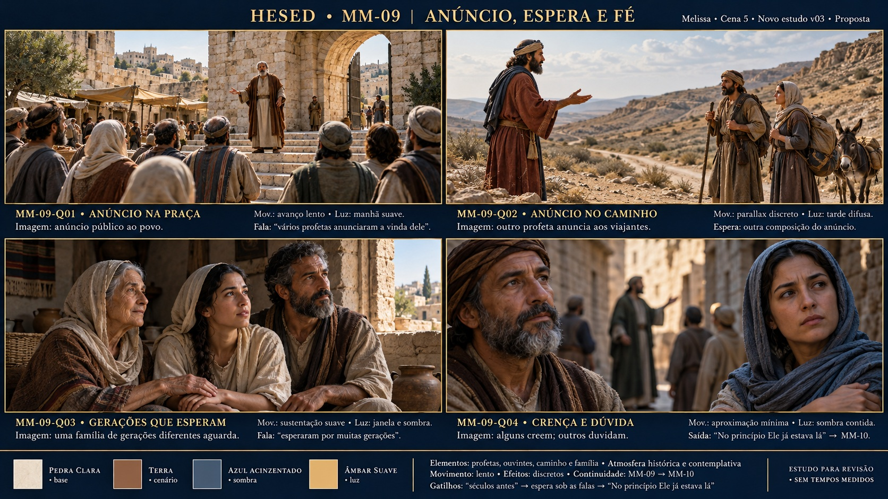

# Storyboard · MM-09 · Anúncio, espera e fé

| | |
| --- | --- |
| **Responsável / cena** | Melissa · Cena 5 · Bloco III |
| **Versão / situação** | **Novo estudo v03**, criado do zero · 16/10/2026 · proposta para revisão |
| **Recebe de** | Frame/fornecedor de entrada não definido |
| **Entrega para** | Eduardo/MM-10: estado visual e paleta; costura a alinhar |
| **Entrada** | “Séculos antes de Jesus nascer, houveram vários profetas...” |
| **Saída** | “No princípio Ele já estava lá” |
| **Controle** | Fala variável; poucas composições/espera, sem música própria ou tempos medidos |
| **Drive** | A definir (P-13); nenhum upload realizado |

## Reinício do zero · D-27

O usuário recusou as versões anteriores por confusão/repetição e determinou excluí-las e refazer. **V01, V02, STB MM09.png e prompts antigos foram retirados da pasta.** A geração nova recebeu somente texto: nenhuma imagem anterior foi usada como referência. “v03” identifica o novo arquivo, não uma continuação estética. A proposta atual ainda depende de avaliação.

[Prancha nova](prancha-v03.jpg) · [Prompt efetivo](prompt-prancha-v03.txt) · [Contrato e registro](../briefings-dos-quadros.md#mm-09--profetas)

## Relação com o roteiro

A Cena 5 pede **“Profetas pregando e anunciando a vinda do Messias no telão”**. As falas tratam de vários anunciadores, espera por gerações e pessoas que acreditam ou duvidam. A proposta distribui essas ideias em quatro situações visualmente diferentes, mantendo a contemplação e a baixa distração do briefing.

Os cenários específicos, família e gestos são interpretações propostas, não novas cenas escritas no roteiro. Profetas são genéricos, sem nomes/versículos/datas inventados. Não antecipar Cristo/cosmos/nascimento: a mudança de registro começa no MM-10. Elenco/humor ficam no palco; ouvintes projetados não representam as detentas.

## Quadros e sustentação

| ID | Imagem / função | Movimento / luz propostos | Uso na fala |
| --- | --- | --- | --- |
| MM-09-Q01 · Anúncio na praça | Plano aberto por trás do público, profeta anuncia junto à porta da cidade | Avanço lento, manhã suave | Entrada na explicação sobre profetas |
| MM-09-Q02 · Anúncio no caminho | Outro profeta de perfil numa estrada, dois viajantes param para ouvir | Parallax discreto, tarde difusa | Outra composição de anúncio, sem corte obrigatório |
| MM-09-Q03 · Gerações que esperam | Plano próximo de três adultos de idades diferentes em casa antiga | Sustentação suave, janela/sombra | Apoio a “esperaram por muitas gerações” |
| MM-09-Q04 · Crença e dúvida | Reações em primeiro plano; outro profeta ao fundo da rua | Aproximação mínima, sombra contida | Apoio a “alguns acreditaram, outros não”; saída MM-10 |

Quatro composições por função, não quatro variações do mesmo grupo pregando. Não repetir Q01 em Q04 para fechar ciclo. O futuro loop/variações deve suportar falas de duração variável, com transições discretas e saída pelo gatilho em qualquer fase, sem obrigar atores a esperar uma volta. Repetição/alpha ainda não testados; gestos não têm animação ou fala labial produzidas.

## Direção visual comum

| Paleta (amostras na prancha) | Função |
| --- | --- |
| Pedra clara | Base da arquitetura |
| Terra | Cenários, chão e tecidos |
| Azul acinzentado | Sombra/atmosfera |
| Âmbar suave | Luz e acentos |

**Luz/atmosfera:** histórica e contemplativa, com variação coerente entre exterior/interior, evitando a mesma paisagem de pôr do sol em tudo. **Elementos:** profetas, povo, caminho, animal de carga discreto e família. **Efeitos:** lentos/discretos, sem glória antecipada. **Continuidade:** unidade de linguagem e época, não mesma locação ou mesma hora para gerações distintas; MM-09 → MM-10 na fala definida. Arquitetura/roupas não comprovam reconstrução histórica exata.

## Fontes e arquivo

[Roteiro Cena 5](../../docs/roteiro.md), [briefing MM-09](../../docs/briefing.md), [Bíblia](../../docs/fontes/HESED_Biblia_de_Producao_v0_1.md) §§3/5.2/9, [D-25/D-26/D-27](../../docs/decisoes.md), [alinhamento](../../docs/alinhamento-das-fontes.md), [Melissa](../../equipe/melissa.md), [mapa](../../docs/mapa-de-cenas.md), [dependências](../../docs/dependencias.md), [guia](../guia-de-construcao.md) e [briefings por quadro](../briefings-dos-quadros.md#mm-09--profetas). Transcrição original ausente (P-14).

- Ferramenta `image_gen.imagegen`, fundo opaco, geração nova **sem referências de imagem**.
- Original: `/workspace/generated_images/exec-db235b08-230e-4182-a9ba-5f2496e2bb8d.png`, PNG 1672×941, 2716118 bytes, fora do repositório.
- [Arquivo leve](prancha-v03.jpg): JPEG **1672×941**, **622485 bytes**, mesma composição na conversão. Próximo de 16:9; não base 4K/matriz LED (P-01).
- Versões excluídas são recuperáveis no histórico Git, mas não são referência atual. Artes oficiais MM-01/MM-03/MM-05 e materiais de Eduardo preservados.

## Revisão

As quatro funções têm ambientes/enquadramentos distintos. Q01 traz mais figurantes e arquitetura mais monumental do que o proposto; são escolhas de execução para avaliação. A família Q03 é uma interpretação de espera, não uma cena literal da fonte. Não há animação/loop validado nem arquivo de integração MM-10 aprovado.

**Aprovação artística pendente.** Sem alpha, Drive ou teste no LED. Revisar a nova abordagem antes de produzir bases individuais e costura técnica.
